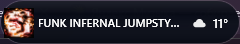
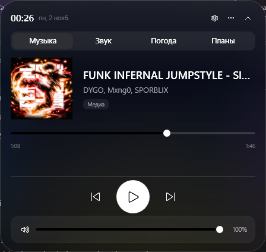
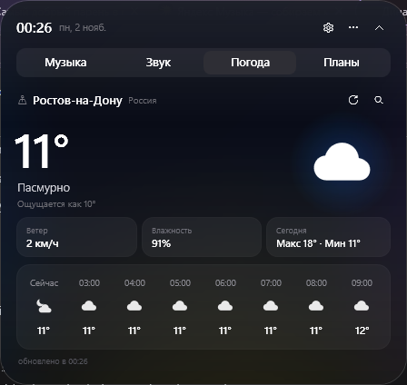
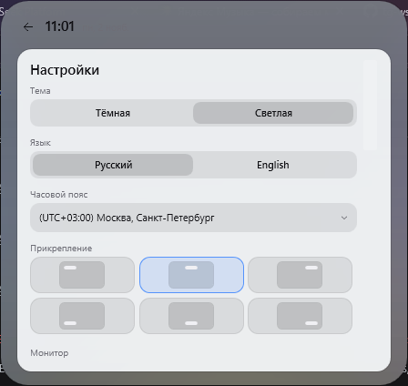

# Island

**A dynamic island for Windows 11.** A pill at the edge of your screen that expands on hover: live blurred glass,
the current track, weather, notes, reminders, your calendar and quick actions — without a window in your taskbar.

Island is a lightweight WPF desktop widget for people who want their daily context one hover away.



## Features

- **Live glass** — the panel blurs the real desktop content behind it; falls back to the wallpaper when capture is unavailable.
- **Visible in captures** — a setting turns live glass off so OBS, Discord and screenshots can see the island.
- **Steps aside in fullscreen** — hides automatically in games and fullscreen video.
- **Multi-monitor aware** — primary display, display under the cursor or a specific monitor; never overlaps the taskbar (including auto-hide).
- **Quick actions** — `Ctrl+Alt+Space` opens a command bar: type a note, a reminder ("in 20 minutes", "on Wednesday at 15:00") or a timer ("timer 25").
- **Reminders in natural language** (Russian and English), with presets and a preview of the parsed schedule.
- **Windows notifications** — custom toast with 5/10/30-minute snooze; quiet hours and Focus Assist are respected.
- **Calendar (ICS)** — upcoming meeting shown in the header and a toast 15 minutes before it.
- **Weather** — current conditions, hourly and 5-day forecast, precipitation, wind/storm warnings, multiple cities.
- **Notes** — checklists, markdown preview, export/import, folder sync, autosave and desktop sticky notes.
- **Music** — Windows media sessions (SMTC), lyrics from LRCLIB, output device switching and volume presets.
- **Themes** — dark, light or system; accent colour from album art; animation speed and reduce motion.
- **System tab** — CPU, GPU and RAM usage from Windows performance counters.
- **Tray and autostart**, plus automatic update checks (download verified with SHA-256, install on confirmation).





## Status

- Version **0.1.0** (pre-1.0). The feature set is complete for a first public release.
- Platform: **Windows 10 2004+ / Windows 11, x64**.
- Built with **.NET 10** and **WPF**; single runtime dependency: **NAudio 2.2.1** (MIT).
- The release binaries are **not code-signed**; Windows SmartScreen may warn on first launch.

## Install

1. Download `Island-0.1.0-win-x64-selfcontained.zip` (no runtime required) or
   `Island-0.1.0-win-x64-framework.zip` (requires the .NET 10 Desktop Runtime) from the release page.
2. Extract the archive and run `Island.exe`.
3. Hover the pill to expand it. Use the tray icon to open settings, enable autostart or exit.

Detailed steps: [docs/INSTALLATION.md](docs/INSTALLATION.md).

## Build from source

Requirements: Windows 10 2004+ / 11, .NET SDK 10.0.

```powershell
git clone <repository-url>
cd island
dotnet build src/Island/Island.csproj
.\Island.cmd
```

Test suite:

```powershell
dotnet run --project tests/ParserTests/ParserTests.csproj
```

## Documentation

- [Documentation index](docs/README.md)
- [User guide](docs/USER_GUIDE.md)
- [Installation](docs/INSTALLATION.md)
- [Troubleshooting](docs/TROUBLESHOOTING.md)
- [FAQ](docs/FAQ.md)
- [Privacy](docs/PRIVACY.md)
- [Architecture](docs/ARCHITECTURE.md)
- [Development](docs/DEVELOPMENT.md)
- [Security policy](SECURITY.md)
- [Contributing](CONTRIBUTING.md)
- [Changelog](CHANGELOG.md)
- [Release notes draft](RELEASE_NOTES_DRAFT.md)

## Privacy

Island has **no telemetry and no analytics**. Data lives in `%APPDATA%\\Island` and can be deleted at any
time. Network access is limited to: Open-Meteo (weather and geocoding), LRCLIB (lyrics), your own ICS calendar URL,
and GitHub (update checks). Details: [docs/PRIVACY.md](docs/PRIVACY.md).

## Known limitations

- Windows toast **actions** are not implemented; action buttons live in Island's own toast window.
- Screen capture uses `CopyFromScreen`; a Windows.Graphics.Capture implementation is planned.
- Screen recording, calls and download progress are not shown — there is no reliable public source for them.
- DPI above 100% has not been tested on hardware (the code accounts for per-monitor DPI).

## Reporting issues

Use GitHub Issues for bugs and feature requests. For security issues, follow [SECURITY.md](SECURITY.md)
(do not open a public issue). Include the Island version, Windows build, monitor/DPI configuration and the
relevant part of `%APPDATA%\\Island\\error.log` (without calendar URLs or personal data).

## License

Island is released under the **MIT License** — see [LICENSE](LICENSE).
