# Островок 0.1.0

Динамический островок для Windows 11: пилюля у края экрана, раскрывается при наведении,
живое стекло с реальным содержимым окон, музыка, погода, заметки и напоминания,
быстрые действия с клавиатуры.


## Что умеет

**Пилюля и окно**
- обложка, трек и эквалайзер, когда играет музыка; часы и дата, когда тихо;
- погода справа, клик по температуре открывает вкладку «Погода»;
- раскрывается при наведении, сворачивается через 0,75 с;
- **не перекрывает панель задач** (учитывается рабочая область, автоскрытие, DPI);
- **выбор монитора**: основной, под курсором или конкретный; переключение на лету;
  реакция на смену разрешения, DPI и конфигурации мониторов.

**Живое стекло**
- размывает реальное содержимое окон за панелью (захват экрана + box blur);
- островок исключён из захвата через `WDA_EXCLUDEFROMCAPTURE`, поэтому не размывает сам себя;
- при выключении настройки, на батарее или при ошибке захвата — fallback на обои;
- 14 fps только в раскрытом состоянии; в свёрнутом — почти ноль CPU.

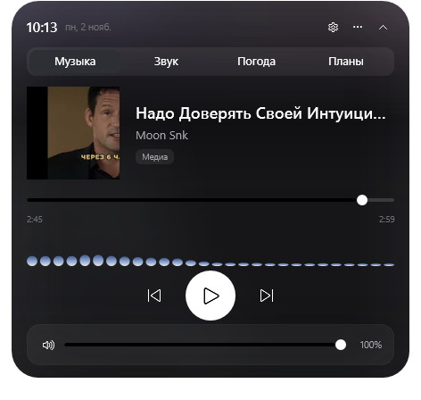

**Таймер**
- «таймер 25» / «25 мин» / `/timer 25` в быстрых действиях;
- обратный отсчёт в пилюле, отмена кликом, тост по завершении.

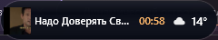

**Быстрые действия**
- глобальный **Ctrl+Alt+Space** открывает командную строку;
- Enter: текст с расписанием становится напоминанием, иначе — заметкой;
- пункт «Быстрые действия» в меню.

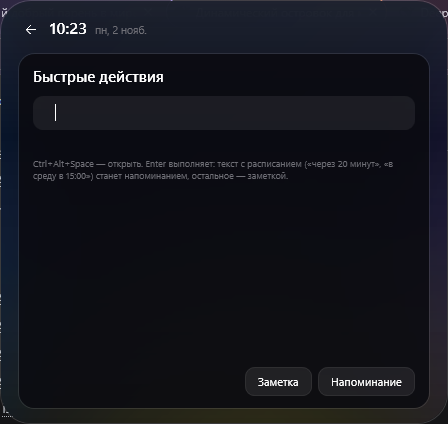

**Напоминания на естественном языке**
- «через 20 минут», «через 2 часа», «каждый час», «каждый день в 9:30»,
  «в среду в 15:00», «завтра в 10», «15:45», «по будням»;
- английский: «in 20 minutes», «every monday at 9», «daily at 18:00»;
- предпросмотр распознанного расписания до сохранения;
- пресеты «Вода», «Разминка», «Duolingo» (заполняют редактор, можно менять).

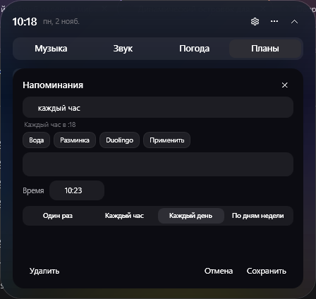

**Уведомления**
- тост с кнопками «5 / 10 / 30» минут и «Готово», без кражи фокуса;
- **тихие часы** (интервал, в т.ч. через полночь) и учёт **Focus Assist / Не беспокоить**;
- защита от повторных срабатываний после перезапуска.

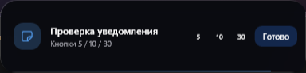

**Календарь** (ICS)
- ссылка на календарь в настройках (webcal:// или https://), кэш на случай офлайна;
- за 15 минут — тост «Через N мин · Событие» и строка в шапке;
- повторы, исключения (EXDATE) и отмены (CANCELLED) учитываются.

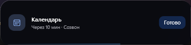

**Погода** (Open-Meteo)
- текущая погода, «ощущается как», ветер, влажность, макс/мин;
- почасовой прогноз на 8 часов;
- **5-дневный прогноз** с вероятностью осадков;
- **предупреждения**: гроза, сильный ветер, ливень;
- **несколько городов**: ‹ › в шапке, добавление через поиск, список сохраняется;
- кэш на случай отсутствия сети, время обновления.

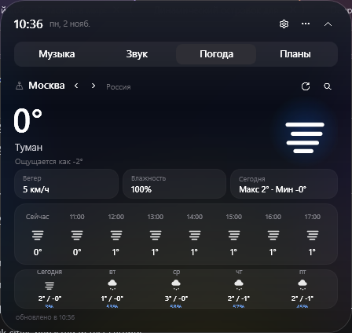

**Система**
- вкладка с загрузкой CPU, GPU и RAM (реальные счётчики Windows);
- обновление раз в секунду, только когда вкладка открыта.

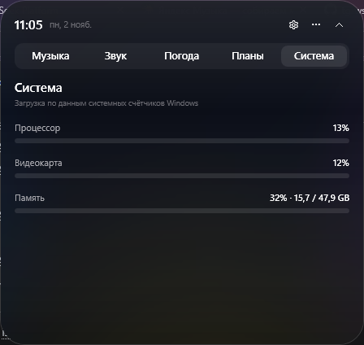

**Темы**
- **тёмная, светлая и системная** тема: переключение в настройках, применяется сразу;
- **акцент из обложки** и **скорость анимаций** 0.5–2×, режим «уменьшить движение».


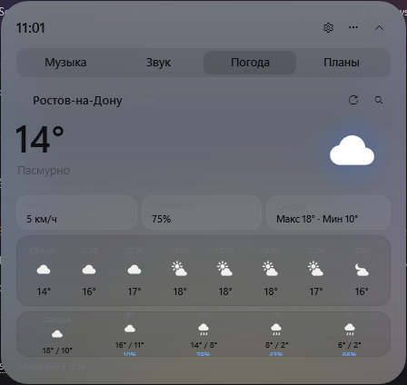

**Темы и движение**
- **акцент из обложки**: стекло и эквалайзер подкрашиваются доминирующим цветом трека;
- **скорость анимаций** 0.5–2× и режим «уменьшить движение».

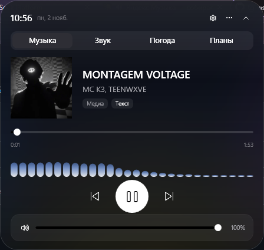

**Устройства вывода**
- список активных устройств и переключение одним выбором (реальный `IPolicyConfig`).

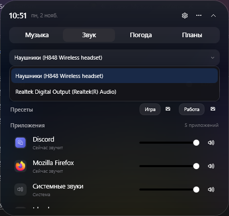

**Пресеты громкости**
- «Игра» и «Работа»: сохраняют мастер-громкость и уровни приложений, применяются одним кликом.

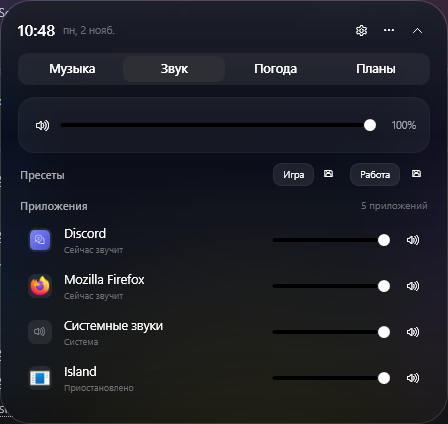

**Текст песни**
- кнопка «Текст» на странице музыки: текущая и следующая строка, синхронизация с позицией;
- источник — LRCLIB (бесплатно, без ключа); если текста нет — честное «Нет текста»;
- для треков без синхронизации показывается пометка «Без синхронизации».

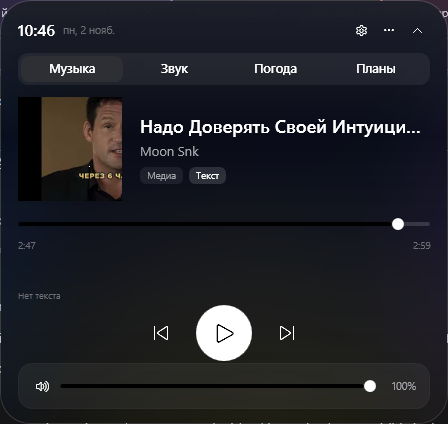

**Музыка** (SMTC) и **Звук** (Core Audio) — как раньше:
обложка, управление, визуализатор, микшер приложений.

**Настройки**
- язык RU/EN на лету;
- часовой пояс;
- прикрепление к шести позициям;
- монитор;
- плотность фона;
- живое стекло;
- визуализатор;
- тихие часы;
- звук уведомлений;
- автозапуск;
- уменьшить движение;
- репозиторий обновлений.

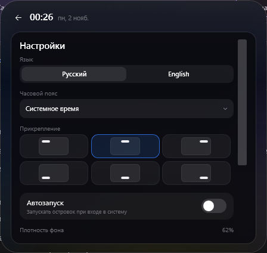
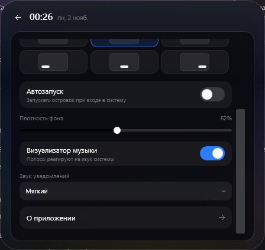

**Трей и автозапуск**
- открыть, быстрые действия, настройки, о приложении, автозапуск, выход;
- автозапуск пишется в `HKCU\Software\Microsoft\Windows\CurrentVersion\Run`.

**О приложении**
- версия 0.0.1 (dev), открытый исходный код, источники данных.

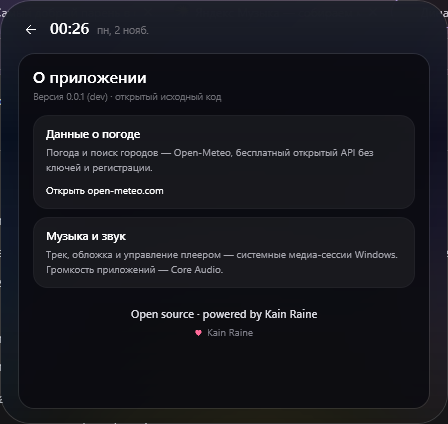

## Управление

| Действие | Что делает |
| --- | --- |
| навести на пилюлю | раскрыть |
| увести курсор | свернуть через 0,75 с |
| Ctrl+Alt+Space | быстрые действия / свернуть |
| клик по температуре | вкладка «Погода» |
| Esc / «⌃» | свернуть или закрыть настройки/редактор |
| «⚙» | настройки |
| «⋯» | меню: быстрые действия, настройки, о приложении, обновления, погода, свернуть, выход |

## Запуск

`Island.cmd` или:

```powershell
.\run.ps1
```

Нужен .NET 10 SDK. Окно всегда поверх, не в панели задач и Alt-Tab, прозрачные области
не перехватывают клики.

## Данные

- `%APPDATA%\Island\settings.json` — все настройки, заметки и напоминания;
- `ISLAND_DATA_DIR` — переопределить каталог (портативный режим/тесты);
- `%APPDATA%\Island\error.log` — ошибки, включая сбои сохранения настроек.

## Тесты

```powershell
dotnet run --project island/tests/ParserTests/ParserTests.csproj
```

21 проверка: парсер расписаний (RU/EN), очистка заголовка, тихие часы.

## Как сделано

- **WPF / .NET 10**, без сторонних UI-библиотек.
- Окно фиксированного размера, per-pixel прозрачность, анимация одним циклом `CompositionTarget.Rendering`.
- **Позиционирование** — `SetWindowPos` в физических пикселях по `GetMonitorInfo`/`GetDpiForMonitor`;
  рабочая область вычитает полосу панели задач даже при автоскрытии (`SHAppBarMessage`).
- **Живое стекло** — `Graphics.CopyFromScreen` + downsample 1/4 + box blur; окно исключено
  из захвата `SetWindowDisplayAffinity(WDA_EXCLUDEFROMCAPTURE)`.
- **Музыка** — WinRT SMTC. **Звук** — NAudio/Core Audio. **Визуализатор** — WASAPI loopback + FFT.
- **Погода** — Open-Meteo. **Время** — TimeZoneInfo.
- **Хоткей** — `RegisterHotKey`. **Уведомления** — окно без активации, `SHQueryUserNotificationState`.
- **Локализация** — два ResourceDictionary и DynamicResource.
- **Трей** — WinForms NotifyIcon.

```
island/
  src/Island/
    MainWindow.xaml(.cs)      пилюля, стекло, вкладки, меню, хоткей
    Views/                    Музыка, Звук, Погода, Планы, Настройки, О приложении, Быстрые действия
    ViewModels/               состояние, заметки/напоминания, настройки
    Services/                 медиа, звук, погода, стекло (обои и живое), спектр,
                              напоминания, парсер времени, уведомления, энергия, обновления
  tests/ParserTests/          тесты парсера и тихих часов
```

## Ограничения и что дальше

- живое стекло не показывает DRM-контент (чёрный) и скрывает островок из скриншотов;
- календарь работает только через ICS (OAuth Outlook/Google и RECURRENCE-ID-переопределения — в планах);
- обновление скачивается только при наличии `sha256` в описании релиза и после подтверждения;
- светлое стекло пока не сделано: нужен вынос цветов в theme-словари и проверка контраста;
- пока нет: закрепления заметок на рабочем столе,
  5-дневного прогноза и нескольких городов, чек-листов/markdown/синхронизации заметок,
  светлой темы и акцента из обложки — см. ROADMAP.md и NEXT_ACTIONS.md.
