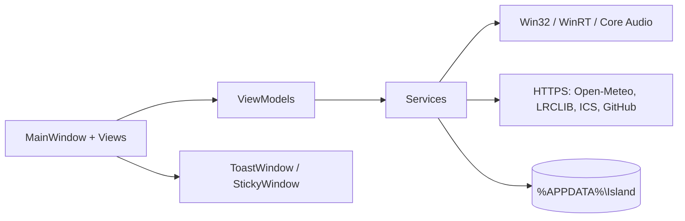

# Architecture

## Overview

Island is a single-process WPF application (`net10.0-windows10.0.19041.0`) with no backend. The UI is a
borderless, always-on-top layered window; all state is local.

## Components

| Layer | Responsibility |
| --- | --- |
| `MainWindow` | Shell, glass, tab switching, overlays (settings/about/quick actions), tray, global hotkey, toasts, sticky windows, the 250 ms tick |
| Views | Pages and sheets; XAML only plus small code-behind for clicks and dialogs |
| ViewModels | Observable state for media, sound, weather, plans, settings, system |
| Services | Windows and network integrations; no UI dependencies |

### Services

- `MediaService` — SMTC sessions via WinRT (track, artwork, controls, position).
- `AudioService` — NAudio/Core Audio: master volume, per-app sessions, output devices via `IPolicyConfig`,
  volume preset capture/apply.
- `SpectrumService` — WASAPI loopback + FFT for the visualizer.
- `WeatherService` — Open-Meteo geocoding and forecast (current, hourly, daily, precipitation).
- `GlassService` — wallpaper bitmap and blur (fallback glass).
- `LiveGlassService` — `CopyFromScreen` capture of the shell region, downscale + box blur;
  `SetWindowDisplayAffinity(WDA_EXCLUDEFROMCAPTURE)` excludes the island from capture.
- `CalendarService` / `IcsCalendar` — ICS fetch and parsing (TZID, Z, all-day, RRULE, EXDATE, CANCELLED).
- `LyricsService` — LRCLIB lyrics (synced LRC or plain).
- `ReminderService` / `ReminderLogic` — scheduling, repeats, descriptions; `LastFired` prevents duplicates.
- `TimerService` — single countdown timer for the pill.
- `NotificationPolicy` — quiet hours and `SHQueryUserNotificationState` (Focus Assist).
- `ToastService` — Windows toast attempt with AUMID; the custom `ToastWindow` is the fallback and the
  only path with action buttons.
- `UpdateService` — GitHub release check, asset selection, SHA-256 verification, download.
- `HardwareMonitor` — CPU/RAM counters and GPU Engine performance counters.
- `SettingsStore` — load/save/migrate `settings.json`, atomic write, error log.
- `NotesSync` — JSON export/import and folder merge by `Updated`.
- `AutoStartService`, `NotificationSoundService`, `LogRotation` — small helpers.

## Lifecycle

1. `App.OnStartup`: single-instance mutex, error-log rotation, toast AUMID registration.
2. `MainWindow` constructor: load settings, merge notes from the sync folder, apply theme and language,
   create view models/services, wire events.
3. `OnSourceInitialized`: tool-window style, hotkey registration, live-glass exclusion, dock position.
4. `OnLoaded`: glass init, tabs, timers, tray, first media/weather/calendar refresh, pinned sticky notes.
5. Every 250 ms: clock/date, media view-model update, equalizer, meeting hint; periodic media/audio/weather/
   calendar refreshes.
6. `OnClosing`: stop timers, remove the hook, dispose services, close sticky notes, save settings.

## State and data flow

- `AppSettings` is the single source of truth, persisted on every change.
- View models copy values from services and raise property changes; XAML binds to them.
- Settings changes raise events (`DockChanged`, `ThemeChanged`, `LiveGlassChanged`, …) that `MainWindow`
  handles immediately.
- Network calls are asynchronous and never block the UI thread; failures keep the last cached data.

## Threading

All UI and timers run on the WPF dispatcher. NAudio callbacks and HTTP continuations marshal back through
`await`. There are no background worker threads owned by the app.

## Error handling and cleanup

- `DispatcherUnhandledException` writes the exception to `error.log` and keeps the app alive.
- Services catch failures, record a message where useful and return safe defaults.
- `SettingsStore.Save` is atomic; a failed save is logged, never fatal.
- Disposables (spectrum, audio, timers, tray icon, hardware counters) are released in `OnClosing`.

## Limitations and technical debt

- Screen capture uses GDI `CopyFromScreen`; Windows.Graphics.Capture would reduce CPU but needs D3D interop.
- Windows toast actions require a COM activator and are not implemented; the custom toast keeps the buttons.
- The app is x64-only and has no installer (portable archive).
- Sticky-note positions are stored per note; monitor changes may place them off-screen until moved.
- No automated UI tests; the test project covers pure logic only.
